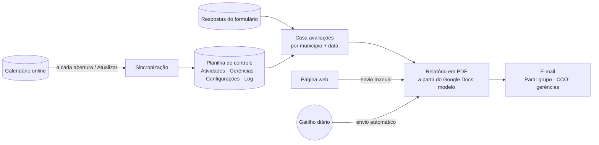

# Relatórios de Avaliação do Apoio Técnico (ATM)

Sistema em **Google Apps Script** que transforma o calendário de atividades de Apoio Técnico e as respostas do formulário de avaliação em **relatórios em PDF**, enviados por e-mail às gerências participantes, de forma **manual** (pela página) ou **automática** (no dia útil seguinte à atividade).

Tudo roda na conta Google de quem instala, vinculado a uma **planilha de controle**. Não há servidor, banco de dados nem senha de e-mail para guardar.

---

## Índice

1. [O que o sistema faz](#o-que-o-sistema-faz)
2. [Como funciona](#como-funciona)
3. [Pré-requisitos](#pré-requisitos)
4. [Instalação passo a passo](#instalação-passo-a-passo)
5. [Configuração](#configuração)
6. [Modelo do relatório (Google Docs)](#modelo-do-relatório-google-docs)
7. [Uso no dia a dia](#uso-no-dia-a-dia)
8. [Envio automático](#envio-automático)
9. [Atualizar o sistema](#atualizar-o-sistema)
10. [Problemas comuns](#problemas-comuns)
11. [Estrutura do repositório e desenvolvimento](#estrutura-do-repositório-e-desenvolvimento)
12. [Limitações conhecidas](#limitações-conhecidas)
13. [Segurança e privacidade](#segurança-e-privacidade)

---

## O que o sistema faz

- **Lê o calendário online** (Google Planilhas) e extrai os ATMs (Apoios Técnicos) da semana: município, data, modalidade (Presencial/Remoto), gerências e nº do processo.
- **Lê as respostas do formulário** de avaliação (Google Forms/Planilhas) e associa cada resposta à atividade correta, por **município + data**.
- **Lê também as Oficinas** do calendário (faixa **AÇÕES**, texto começando com `Oficina:`), com o nome da oficina, o município e as gerências.
- **Gera um relatório por gerência participante** (em PDF **e em Word**) a partir de um **Google Docs modelo** (um para ATM e outro para Oficina), com gráficos por setor e por pergunta e tabelas de comentários. Cada avaliação vai para a gerência da sua Unidade/Setor (aba **Unidades x Gerências**).
- **Envia um e-mail por gerência** por atividade, com o PDF daquela gerência anexado e os e-mails da gerência em CCO. O Word fica no Drive, para edição manual.
- Oferece uma **página web** (semana de segunda a sexta) com o status de cada envio, um painel de **revisão** de dados do calendário e o controle do **envio automático** (liga/desliga).

## Como funciona



1. **Sincronização.** Ao abrir ou recarregar a página (ou clicar em **↻ Atualizar**), o sistema consulta o calendário e as respostas. Os ATMs da semana (segunda a sexta) são gravados na aba **Atividades** da planilha de controle. Mudanças (novo, alterado, removido) ficam registradas na aba **Mudanças do calendário**.
2. **Casamento das avaliações.** Para cada atividade, contam-se as respostas do mesmo município na mesma data. Opcionalmente entram também as respostas do **dia seguinte**, desde que o município não tenha outra atividade nesse dia; a tela mostra o total somado, sem separar por dia, por exemplo um único número somado (ex.: `12`).
3. **Relatório.** Para cada gerência participante, o sistema copia o Docs modelo, troca os marcadores (`{{MUNICIPIO}}`, `{{DATAS}}`, `{{OFICINA}}`...), insere gráficos e tabelas no lugar de `{{CONTEUDO}}` e exporta **PDF e Word**. Os arquivos ficam em uma **subpasta por atividade** (`aaaa-mm-dd - Município`) dentro de *Relatórios ATM - PDFs* no Drive; o link da pasta aparece na tela e na planilha.
4. **Envio.** Manual (você revisa e edita o e-mail na página) ou automático (gatilho diário).

### Regras de negócio

| Regra | Detalhe |
|---|---|
| Semana | Apenas **segunda a sexta**. ATM em sábado/domingo é ignorado e gera um aviso. |
| Atividade | Mesmo município no mesmo dia = **uma só atividade** (gerências e modalidades são unidas). |
| Gerências aceitas | `GEBEN, GEPSB, GEPMC, GEFEAS, VSA, CAD, GETEP, GEPAC`. Apelidos tratados: `GFEAS→GEFEAS`, `GEFAS→GEFEAS`, `GEPBS→GEPSB`; `GVINF` vira `CAD` e `VSA`. |
| Municípios | Lista oficial dos 185 municípios de Pernambuco; grafias próximas são corrigidas (ex.: "Garanhus" → "Garanhuns"). |
| Revisão | ATM sem município reconhecido ou sem gerência válida **não entra na lista** até você corrigir e confirmar. |
| ATM x Oficina | ATM = município + data. Oficina = município + data + nome. Como o formulário é o mesmo, se um município tiver duas atividades no mesmo dia, as avaliações entram nas duas e a aba Revisão avisa. |
| Gerência da avaliação | Pela **Unidade/Setor** da resposta e a aba **Unidades x Gerências**: vai para a gerência **primária** se ela participou da atividade; senão para a **secundária**, se participou; senão (nenhuma das duas participou, ou unidade fora da tabela) para **todas** as gerências participantes. |
| Dia seguinte | Respostas datadas do dia seguinte entram se o município não tiver outra atividade nesse dia (configurável). |
| Proteção | Se a leitura do calendário vier vazia ou com menos da metade dos ATMs já cadastrados na semana, **nada é alterado** e a página avisa (com opção de aceitar mesmo assim). |

---

## Pré-requisitos

- Uma **conta Google** (Workspace ou pessoal) com acesso para **abrir** o calendário, a planilha de respostas e o Docs modelo.
- O **calendário** no formato esperado (ver [Formato do calendário](#formato-do-calendário)).
- A **planilha de respostas** do formulário de avaliação (ver [Formato das respostas](#formato-das-respostas)).
- Um **Google Docs modelo** do relatório (ver [Modelo do relatório](#modelo-do-relatório-google-docs)).
- (Opcional) Um endereço de grupo para enviar "como" (ex.: `atm@seu-dominio`), cadastrado em *Enviar e-mail como* no Gmail da conta.

### Formato do calendário

O leitor foi escrito para o layout da planilha *Calendário ATM - SEASS*:

- uma **aba por mês**, com os nomes `JANEIRO` … `DEZEMBRO`;
- cada dia ocupa um bloco de colunas (Dom=C, Seg=E, Ter=H, Qua=K, Qui=N, Sex=Q, Sáb=T) e o número do dia fica na linha de cabeçalho da semana;
- dentro de cada dia, duas faixas: **`ATMs PRESENCIAIS`** e **`ATMs REMOTOS`** (encerradas por **`AÇÕES`**);
- cada ATM fica na 2ª coluna do bloco (texto começando com "ATM…") e o nº do processo na 1ª;
- a linha com **`Informes`** na coluna D encerra a área lida.

Se o seu calendário tiver outra estrutura, ajuste as constantes no topo de `Calendario.gs` (`COLS_DIA`, `COL_INFORMES`, `MESES`).

### Formato das respostas

As colunas são localizadas pelo **título da pergunta** (sem diferenciar maiúsculas/acentos). É preciso haver perguntas cujo título contenha:

| Campo | Trecho procurado no título |
|---|---|
| Município | `nome do município` |
| Data do apoio | `data do apoio` |
| Setor / unidade (opcional) | `unidade` ou `setor` |
| Esclarecimentos | `esclareceu` / `esclarecer` |
| Formato | `formato do apoio` |
| Tempo | `tempo de duração` |
| Forma de explicar | `forma de explicar` |
| Avaliação geral | `no geral` |
| Comentário geral | `comentários, elogios` |
| Comentários por pergunta | colunas com `caso tenha respondido` ou `por gentileza` |

Opções de resposta esperadas: `Sim, totalmente / Parcialmente / Não atendeu` (esclarecimentos, formato e forma de explicar), `Curto demais / Adequado / Longo demais` (tempo) e `Excelente / Bom / Regular / Precisa melhorar` (geral). Respostas fora dessas opções aparecem como "Outras respostas".

---

## Instalação passo a passo

> Tempo estimado: 15 a 20 minutos. Você vai colar **3 arquivos** no editor do Apps Script: `Codigo.gs`, `Index.html` e `appsscript.json`.

### 1. Criar a planilha de controle

1. Em [sheets.new](https://sheets.new), crie uma planilha **em branco** (Google Planilhas nativa, não um `.xlsx` enviado) e dê um nome, por exemplo *Controle Relatórios ATM*.
2. Em **Arquivo > Configurações**, defina o fuso horário como **(GMT-03:00) Recife** (ou o fuso desejado) e salve.

### 2. Abrir o Apps Script a partir da planilha

Dentro da planilha, vá em **Extensões > Apps Script**.
É importante abrir por aqui: o projeto precisa ficar **vinculado à planilha**. Se você criar o projeto direto em script.google.com, o sistema não encontra a planilha de controle.

### 3. Ativar o manifesto

Em **Configurações do projeto** (engrenagem), marque **"Mostrar arquivo de manifesto appsscript.json no editor"**. Volte ao **Editor**: o arquivo `appsscript.json` aparece na lista.

### 4. Colar os arquivos

| No editor | Conteúdo |
|---|---|
| `appsscript.json` | apague tudo e cole o conteúdo de [`appsscript.json`](appsscript.json) |
| `Código.gs` | apague tudo e cole o conteúdo de [`Codigo.gs`](Codigo.gs) |
| **+ > HTML**, nome exatamente **`Index`** | cole o conteúdo de [`Index.html`](Index.html) |

Salve (Ctrl+S).

### 5. Autorizar e criar as abas

1. No seletor de funções do editor, escolha **`garantirEstrutura`** e clique em **Executar**.
2. Aceite as permissões. Se aparecer *"O Google não verificou este app"*, clique em **Avançado > Acessar (não seguro)**: é o seu próprio script.
3. Ao terminar, a planilha ganha as abas **Atividades, Gerências, Configurações, Log** e **Mudanças do calendário**. Isso confirma que o vínculo funcionou.

Permissões solicitadas: Planilhas, Drive, Documentos, Gmail (enviar e ler aliases), gatilhos do script, serviço externo de gráficos e **acesso a serviço externo** (usado para exportar o Word a partir do Google Docs).

### 6. Preencher a planilha de controle

- **Gerências**: preencha a coluna *E-mail corporativo* de cada gerência (vários e-mails separados por `;`). Gerência sem e-mail não recebe cópia.
- **Configurações**: revise, principalmente, `CALENDARIO_URL`, `RESPOSTAS_PLANILHA`, `MODELO_RELATORIO`, `REMETENTE` e `EMAIL_PARA` (veja a [tabela de configuração](#configuração)).

### 7. (Opcional) Enviar como um grupo

Para que os e-mails saiam de um endereço de grupo (ex.: `atm@seu-dominio`), no Gmail da conta que hospeda o sistema:

1. **Configurações > Contas e importação > Enviar e-mail como > Adicionar outro endereço**.
2. Informe o nome e o e-mail do grupo, marque **"Tratar como um alias"** e confirme com o código enviado ao grupo.

Se o endereço não estiver cadastrado, ou se o administrador do domínio bloquear, o sistema **envia pela própria conta** e avisa na página e no `Log`. A aba **Automático** mostra qual remetente será usado.

### 8. Implantar como App da Web

1. **Implantar > Nova implantação**, engrenagem ao lado de *Selecionar tipo* > **App da Web**.
2. **Executar como:** *Eu*. **Quem pode acessar:** *Qualquer pessoa da organização* (ou a opção que seu domínio permitir).
3. **Implantar** e copie a **URL** (termina em `/exec`). É o endereço da página do sistema.

> Importante: a página roda com a **sua** conta. Os e-mails saem dela. Para restringir quem pode usar, preencha `USUARIOS_PERMITIDOS` em Configurações.

### 9. Primeiro uso (com o modo teste ligado)

1. Abra a URL: a aba **Semana** carrega as atividades e as contagens.
2. Na aba **Automático**, use **Simular** (não envia nada) e **Executar agora** (com o **modo teste ligado**, o e-mail vai só para o endereço de teste).
3. Gere um envio manual (**Preparar envio**) e **confira o PDF** e o e-mail.
4. Só depois desligue o modo teste e ligue o envio automático.

---

## Configuração

Aba **Configurações** da planilha de controle (chaves criadas automaticamente na primeira execução; pode editar direto na planilha):

| Chave | Descrição | Padrão |
|---|---|---|
| `CALENDARIO_URL` | Link do calendário online. A conta precisa conseguir abri-lo. | *(preencher)* |
| `RESPOSTAS_PLANILHA` | Link ou ID da planilha de respostas. | *(preencher)* |
| `RESPOSTAS_ABA` | Nome da aba das respostas (se não existir, usa o GID e, por fim, a 1ª aba). | `Sheet1` |
| `RESPOSTAS_GID` | GID da aba das respostas. | `0` |
| `INCLUIR_DIA_SEGUINTE` | `Sim`: respostas do dia seguinte entram se o município não tiver outra atividade nele. | `Sim` |
| `CAMPO_DATA_BUSCA` | `data_apoio` (pergunta da data) ou `carimbo` (data/hora do envio da resposta). | `data_apoio` |
| `MODELO_RELATORIO` | Link ou ID do Google Docs modelo do relatório de **ATM**. Vazio = PDF simples (sem Word). | *(preencher)* |
| `MODELO_RELATORIO_OFICINA` | Link ou ID do Google Docs modelo do relatório de **Oficina**. | `1npMS_utFpPJauKD0wDMFrwFn9DFI09kBnM19EEw_HQk` |
| `AUTOMATICO` | `Sim`/`Não`. Também se altera na página (aba Automático). | `Não` |
| `HORA_AUTOMATICO` / `MINUTO_AUTOMATICO` | Horário aproximado do envio automático. | `17` / `0` |
| `MODO_TESTE` | `Sim`: o automático envia só para `EMAIL_TESTE` e não marca nada como enviado. | `Sim` |
| `EMAIL_TESTE` | Destino dos testes (vazio = a conta que hospeda o sistema). | vazio |
| `REMETENTE` | Endereço preferido de envio (precisa estar em *Enviar e-mail como*). | *(preencher)* |
| `NOME_REMETENTE` | Nome exibido como remetente. | `NATM` |
| `EMAIL_PARA` | Destinatário fixo (campo *Para*); as gerências vão em CCO. | *(preencher)* |
| `USUARIOS_PERMITIDOS` | E-mails (separados por vírgula) que podem usar a página. Vazio = todos do acesso configurado. | vazio |
| `ASSUNTO_RELATORIO`, `CORPO_RELATORIO` (ATM) e `ASSUNTO_RELATORIO_OFICINA`, `CORPO_RELATORIO_OFICINA` | Texto do e-mail com relatório. Marcadores: `{{MUNICIPIO}}`, `{{DATA}}`, `{{GERENCIA}}` (e `{{OFICINA}}` nas oficinas). Vazio = padrão. | vazio |
| `ASSUNTO_SEM_RESPOSTAS`, `CORPO_SEM_RESPOSTAS` | Aviso manual de "sem avaliações". Vazio = padrão. | vazio |

### Abas da planilha de controle

| Aba | Conteúdo |
|---|---|
| **Atividades** | Um registro por ATM ou Oficina do calendário (colunas **Tipo** e **Nome da oficina** no fim): data, município, modalidade, gerências, processo, observação, **Revisar**, **Não enviar automático**, **Status do envio** (`Enviado` / `Sem avaliações`), nº de avaliações, data/hora, **tipo do envio** (Manual/Automático), **motivo** quando o automático não enviou, link da pasta com PDF e Word (resumo; o detalhe por gerência fica na aba Envios por gerência), situação no calendário e dados técnicos de sincronização. |
| **Gerências** | Nome, gerente, e-mail corporativo e se está ativa. |
| **Unidades x Gerências** | Para cada Unidade/Setor do formulário (nome **idêntico** ao do formulário), a gerência primária e a secundária. Vem preenchida; pode ser editada à vontade. |
| **Envios por gerência** | Uma linha por atividade + gerência: status (Enviado / Sem avaliações / Não enviado), nº de avaliações, data/hora, tipo, motivo e links do PDF e do Word. É daqui que a tela lê o andamento dos envios. |
| **Configurações** | Tabela acima. |
| **Log** | Um registro por envio: data/hora, origem (Manual/Automático/Teste), município, datas, nº de avaliações, destinatários, status, remetente usado, link do PDF e observação. |
| **Mudanças do calendário** | Histórico de eventos: `NOVO`, `ALTERADO`, `REMOVIDO`, `REATIVADO`, `CONFIRMADO`. |

---

## Modelo do relatório (Google Docs)

Há dois modelos: o do **ATM** (`MODELO_RELATORIO`) e o da **Oficina** (`MODELO_RELATORIO_OFICINA`, com `{{OFICINA}}`, `{{MUNICIPIO}}`, `{{DATAS}}`, `{{EMAIL}}` e `{{CONTEUDO}}`). Em cada relatório, `{{EMAIL}}`/`{{GERENCIAS}}` mostram **só a gerência daquele relatório**. O Word é a exportação do próprio Google Docs preenchido (gráficos viram imagens; a paginação pode diferir um pouco do PDF).

O relatório é gerado a partir de um Google Docs que você controla (timbrado, fontes, textos fixos). A cada relatório o sistema **copia** o modelo, preenche e exporta para PDF; a cópia é apagada e só o PDF permanece.

Marcadores reconhecidos (no corpo, no cabeçalho ou no rodapé):

| Marcador | Vira |
|---|---|
| `{{MUNICIPIO}}` | Nome do município |
| `{{DATAS}}` | Data(s) do apoio, ex.: `22/10/2026 e 23/10/2026` |
| `{{MODALIDADE}}` | `Presencial`, `Remoto` ou `Presencial e Remoto` |
| `{{GERENCIAS}}` ou `{{EMAIL}}` | Gerências participantes |
| `{{GERADO_EM}}` | Data e hora de geração (opcional) |
| `{{CONTEUDO}}` | **Obrigatório.** Gráficos, tabelas de comentários e, com mais de uma data, uma seção por data (cada uma em página nova) |

Dicas:

- Coloque `{{CONTEUDO}}` **sozinho em um parágrafo comum** do corpo (não dentro de tabela).
- Se o modelo não tiver `{{MODALIDADE}}`, o sistema insere a linha `Modalidade: ...` logo abaixo da linha das datas.
- A conta que hospeda o sistema precisa conseguir **abrir** o Docs.
- Se o modelo estiver inacessível ou sem `{{CONTEUDO}}`, o sistema gera um **PDF simples** e mostra um aviso na tela do envio.

### Ajustes de layout do PDF

O sistema aplica margens de **100 pt (topo)** e **125 pt (base)** na cópia do modelo, para que o texto não invada a arte do rodapé do timbrado, e distribui os gráficos pelas páginas (2 por página quando não há comentários; com comentários, o gráfico começa numa página que tenha espaço para o início da tabela).
Como a Docs não informa a altura real do conteúdo, a paginação usa **estimativas**. Para ajustar, edite a constante `PAG` no início da seção "PDF a partir do modelo do Google Docs" em `Relatorio.gs`:

| Campo | Função |
|---|---|
| `margemTopo`, `margemBase` | Margens aplicadas ao corpo. Aumente `margemBase` se algo tocar o rodapé. |
| `cabecalhoModelo` | Altura estimada do cabeçalho do modelo na 1ª página. Ajuste se a primeira página sobrar ou faltar espaço. |
| `largura` | Largura dos gráficos (pt). |

---

## Uso no dia a dia

### Aba Semana

- Mostra a semana de **segunda a sexta** com o intervalo em destaque. Use **◀ / ▶**, o seletor de data, **Semana atual** e **↻ Atualizar**.
- Cada **atividade** (ATM ou Oficina) é um **bloco**: data, município, modalidade (ou nome da oficina), **total de avaliações** (número único), link da pasta com PDF e Word e a opção **excluir do automático**.
- Dentro do bloco há **uma linha por gerência participante**, com o nº de avaliações dela e o **status de envio**: *Enviado* (verde, com data, hora e tipo), *Sem avaliações* ou *Não enviado* (com o motivo), além dos links do PDF e do Word.
- **Preparar envio / Reenviar** (por gerência): gera o PDF e o Word, abre uma janela para você editar *Para, CC, CCO, assunto e mensagem*, conferir o PDF e **Enviar** (ou **Criar rascunho no Gmail**). O e-mail leva só o PDF; se editar o Word, anexe-o manualmente (rascunho do Gmail).

### Aba Revisão

- **Atividades para revisar**: ATMs que vieram do calendário sem município reconhecido ou sem gerência válida. Corrija data, município, modalidade e gerências e clique em **Confirmar**; só então a atividade passa a aparecer na semana. A correção vale enquanto o texto daquela célula no calendário não mudar (se mudar, volta para revisão).
- **Avisos** (somente leitura): ATM em fim de semana, avaliações sem atividade correspondente, avaliações recebidas depois do envio e gerências sem e-mail.

---

## Envio automático

Na aba **Automático** você liga/desliga o envio e define o horário. O gatilho roda **de segunda a sexta**, por volta do horário configurado (o Google pode atrasar cerca de 15 minutos), e trata as atividades (ATM e Oficinas) do **dia útil anterior** (na segunda-feira, as de sexta), **uma gerência por vez**.

Um relatório é enviado automaticamente a uma gerência se:

- não estiver **em revisão**;
- não estiver marcada como **Excluir**;
- a gerência ainda **não tiver recebido** o relatório dessa atividade;
- tiver **ao menos 1 avaliação atribuída**;
- a gerência tiver **e-mail válido**.

Cada envio é gravado na hora; se o tempo de execução (6 min) acabar, o que sobrar fica como *Não enviado* e o botão **Executar agora** continua de onde parou.

Resultados possíveis, sempre visíveis na planilha e na página:

| Situação | O que acontece |
|---|---|
| Enviada | Marcada como *Enviado* (tipo *Automático*), com o PDF no Drive e registro no Log. |
| Sem avaliações | **Nenhum e-mail.** A gerência fica como *Sem avaliações* com a hora da verificação. |
| Não enviada (sem e-mail, revisão, falha) | Fica *Não enviado* e o **motivo** aparece na planilha e na página, para envio manual. |

**Modo teste** (ligado por padrão): o automático envia **apenas** para `EMAIL_TESTE`, com assunto `[TESTE]`, e **não marca nada como enviado**. Os botões **Simular** (não envia nada) e **Executar agora** (segue o modo teste) servem para validar antes de ligar de verdade.

---

## Atualizar o sistema

Ao alterar qualquer arquivo no editor (ou colar uma versão nova):

1. Cole o conteúdo novo e salve.
2. **Implantar > Gerenciar implantações > lápis > Versão: Nova versão > Implantar.** A página só passa a usar o código novo depois disso; a URL não muda.
3. Se o código passar a exigir permissões novas, rode qualquer função (por exemplo `garantirEstrutura`) e autorize de novo.

---

## Problemas comuns

| Sintoma | Causa provável / solução |
|---|---|
| A planilha não ganha as abas no passo 5 | O script foi criado fora da planilha. Refaça o passo 2 (Extensões > Apps Script, dentro da planilha). |
| Não aparece "App da Web" ao implantar | O manifesto não foi colado ou o JSON ficou inválido. Refaça o passo 4. |
| "Esta conta não conseguiu abrir a planilha" | O calendário ou a planilha de respostas não está compartilhado com a conta que hospeda o sistema. |
| "Não encontrei no formulário as colunas: ..." | Os títulos das perguntas não batem com os trechos esperados ([tabela](#formato-das-respostas)). |
| "Modelo do Docs indisponível (...)" | A mensagem entre parênteses diz o motivo (sem permissão, sem `{{CONTEUDO}}`, link inválido). O PDF simples é usado até corrigir. |
| Texto do relatório encosta no rodapé | Aumente `margemBase` na constante `PAG` (veja [Ajustes de layout](#ajustes-de-layout-do-pdf)). |
| Os e-mails saem da conta pessoal, não do grupo | O endereço de `REMETENTE` não está em *Enviar e-mail como* no Gmail (aba Automático mostra o diagnóstico). |
| Página mostra o comportamento antigo | Falta criar **nova versão** da implantação. |
| Autorização bloqueada | O administrador do domínio pode restringir apps; peça a liberação. |

---

## Estrutura do repositório e desenvolvimento

```
.
├── README.md
├── appsscript.json        # manifesto (fuso America/Recife, App da Web)
├── Index.html             # página (interface)
├── Codigo.gs              # arquivo único colado no editor (gerado a partir dos .gs abaixo)
├── Util.gs                # datas, texto, e-mails, lista de municípios
├── Logos.gs               # imagem do rodapé do PDF simples (base64)
├── Calendario.gs          # leitura do calendário + sincronização (novo/alterado/removido)
├── Dados.gs               # planilha de controle e respostas do formulário
├── Relatorio.gs           # cálculo das avaliações, PDF simples e PDF pelo modelo do Docs
├── Fluxo.gs               # semana, revisão, e-mails (manual) e envio automático
├── Web.gs                 # entrada da página (doGet) e funções chamadas por ela
└── teste/                 # testes locais (Node.js)
```

`Codigo.gs` é a concatenação dos `.gs` na ordem `Util, Logos, Calendario, Dados, Relatorio, Fluxo, Web`. Depois de editar os arquivos separados, gere-o de novo:

```bash
for f in Util Logos Calendario Dados Relatorio Fluxo Web; do
  echo; echo "// ==== $f.gs"; cat "$f.gs"
done > Codigo.gs
```

### Testes locais

Os testes rodam em **Node.js** (sem acesso ao Google) com serviços simulados (`SpreadsheetApp`, `GmailApp`, `DriveApp`, `DocumentApp`, `Charts`, gatilhos):

```bash
cd teste
node t_calendario.js   # leitura do calendário (compara com a saída de referência) e regras de município/gerência
node t_servidor.js     # sincronização, revisão, semana, envio manual, automático, gatilhos
node t_docs.js         # geração do relatório pelo modelo do Docs
node t_layout.js       # paginação e margens do relatório
BUNDLE=1 node t_servidor.js   # mesmos testes usando o arquivo único Codigo.gs
```

Os testes validam a lógica; o comportamento real do Gmail, do Docs e dos gatilhos só se confirma no Google (por isso o **modo teste** vem ligado).

---

## Limitações conhecidas

- O leitor do calendário depende do **layout específico** descrito acima.
- O gatilho do Google não dispara em horário exato (margem de ~15 min) e **feriados não são tratados**: desligue o automático quando necessário.
- Cada execução do Apps Script tem limite de **6 minutos** e há **cota diária de e-mails** do Gmail/Workspace; o volume típico desta rotina fica bem abaixo.
- Gráficos são imagens do serviço de gráficos do Google (barras com rótulos de quantidade e %); a paginação do PDF usa estimativas de altura.
- Quem acessa a página age com a conta do dono da implantação (os e-mails saem dela).

---

## Segurança e privacidade

- O sistema **não guarda senhas**: o envio usa a autorização da conta Google. Nada de credenciais no código.
- A página é protegida pelo acesso da implantação (por exemplo, só o seu domínio). Use `USUARIOS_PERMITIDOS` para restringir a pessoas específicas.
- As avaliações são anônimas e aparecem apenas agregadas, mais os comentários livres, no relatório.
- **Antes de publicar este repositório**, confira que ele não contém dados reais da instituição: IDs/links de planilhas e Docs, e-mails institucionais e arquivos de teste com dados do calendário ou das respostas. Prefira um repositório **privado** ou substitua esses valores por exemplos.